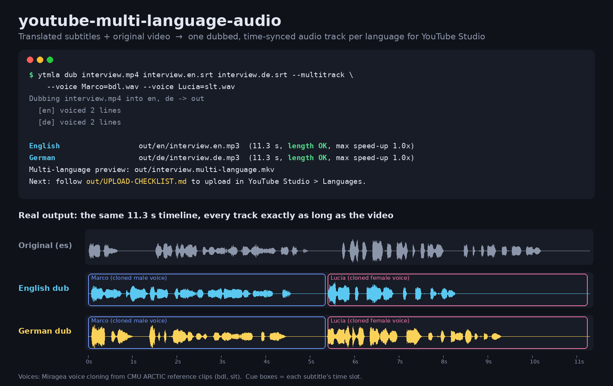
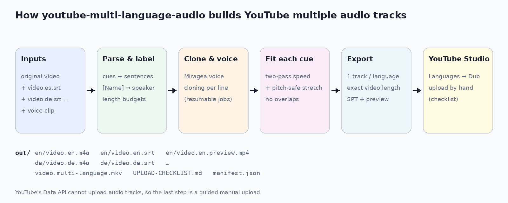

# youtube-multi-language-audio: YouTube multiple audio tracks from your subtitles, in your own cloned voice

[](https://github.com/RTY2345RR/youtube-multi-language-audio/actions/workflows/ci.yml)
[](LICENSE)


**youtube-multi-language-audio is an open-source Python command-line tool that turns translated subtitle files (SRT/VTT) and the original video into dubbed audio tracks for YouTube's multi-language audio feature.** It voices every subtitle cue in a cloned voice (yours, or one per speaker), fits each line into its cue's time slot so the dub stays in sync, and exports one upload-ready track per language, exactly as long as the video, named by language code, with re-timed captions and an upload checklist for YouTube Studio. It is a self-hosted alternative to YouTube auto dubbing for creators who want their own voice and their own translation.



> **Listen to the real demo output** (no edits): [English track](examples/spanish-video-to-english-and-german-audio-tracks/output/en/interview.en.mp3) · [German track](examples/spanish-video-to-english-and-german-audio-tracks/output/de/interview.de.mp3) · [English preview MP4](examples/spanish-video-to-english-and-german-audio-tracks/output/en/interview.en.preview.mp4) · [synced English SRT](examples/spanish-video-to-english-and-german-audio-tracks/output/en/interview.en.srt) · [upload checklist](examples/spanish-video-to-english-and-german-audio-tracks/output/UPLOAD-CHECKLIST.md) · [web page with audio players](https://huggingface.co/spaces/miragea/youtube-multi-language-audio)

## How it works



1. **Read** each translated subtitle file (`video.es.srt`, `video.de.srt`, `video.pt-BR.srt` …). The language comes from the file name. Cue fragments are joined into sentences; `[Anna]` / `Anna:` labels select a speaker.
2. **Clone & voice** every line with the [Miragea](https://miragea.ai) voice-cloning engine, from a 5–15 s reference clip (a file, a URL, or a time range cut straight from the video).
3. **Fit** each line into its slot (from its cue start to the next cue). Lines that run long are voiced again at the right speaking speed (two-pass), then a pitch-preserving stretch handles the rest. Lines never overlap.
4. **Export** per language: `<video>.<lang>.m4a` (AAC, 48 kHz, same length as the video), `<video>.<lang>.srt` re-timed to the dub, a preview MP4, `timing.json`; plus `UPLOAD-CHECKLIST.md`, `manifest.json` and an optional multi-track MKV with every language tagged.
5. **Upload** in YouTube Studio → Languages → Dub. YouTube's public API cannot add audio tracks, so the checklist walks you through it (about a minute per language).

## Features

- **YouTube multi-language audio, ready to upload**: one audio-only track per language, length-matched to the video, named by language code (`talk.es.m4a`, `talk.pt-BR.m4a`).
- **Your own voice**: clone it from any clip, or from a time range of the video itself (`--clone-from-video 12-24`). No reference text? The clip is transcribed automatically.
- **Multi-speaker dubbing**: `[Name]`, `Name:` or `(Name):` labels in the SRT map to one cloned voice per speaker (`--voice Anna=anna.wav --voice Ben=ben.wav`).
- **Time-synced to every cue**: two-pass voicing at the right speaking speed, a capped pitch-safe stretch (`--max-speedup`, default 1.3×), and a report of any line that still needs shortening.
- **Offline fit check**: `ytmla check` estimates which translated lines are too long for their slot before any voice is generated.
- **Resumable, no duplicate jobs**: every voice job is saved with its task id and idempotency key; re-running the same command picks up where it stopped, and unchanged lines are reused.
- **Many languages in one run**, in parallel. Subtitles can be SRT, WebVTT or YouTube `json3`.
- **Extras**: mix a music & effects stem under the voices (`--background`), M4A/WAV/MP3/FLAC output, a multi-language MKV for review or other platforms.
- **One-command install**, ffmpeg included through `imageio-ffmpeg`. MIT licensed.

## Quick start

1. Get a Miragea API key at [miragea.ai/workspace/api](https://miragea.ai/workspace/api) and export it:

   ```bash
   export MIRAGEA_API_KEY=...            # PowerShell: $env:MIRAGEA_API_KEY="..."
   ```

   Using an AI agent? Tell it: `Install https://miragea.ai/skills/miragea-audio/install.md`

2. Run it with [uv](https://docs.astral.sh/uv/) (no install step), or `pip install git+https://github.com/RTY2345RR/youtube-multi-language-audio`:

   ```bash
   uvx --from git+https://github.com/RTY2345RR/youtube-multi-language-audio ytmla dub \
     my-video.mp4 my-video.es.srt my-video.de.srt my-video.pt-BR.srt \
     --voice my-voice.wav
   ```

3. Open `my-video-audio-tracks/UPLOAD-CHECKLIST.md` and upload each track in YouTube Studio.

`ytmla` is a short alias of `youtube-multi-language-audio`; both commands are installed.

## Usage

```bash
# One cloned voice for every language (a 5-15 s clip of clean speech)
ytmla dub talk.mp4 talk.es.srt talk.fr.srt --voice me.wav

# Clone the voice from 10-25 s of the original video (reference text is transcribed for you)
ytmla dub talk.mp4 subs/ --clone-from-video 10-25

# Two speakers labelled [Anna] / [Ben] in the subtitles
ytmla dub talk.mp4 talk.ja.srt --voice Anna=anna.wav --voice Ben=ben.wav \
  --voice-text "Anna=What Anna says in anna.wav"

# Files not named by language? Say it explicitly
ytmla dub talk.mp4 es=spanish-final.srt de=german-v2.srt --voice https://example.com/me.wav

# Before generating: which lines are too long for their slot? (no API key needed)
ytmla check talk.mp4 talk.es.srt talk.de.srt

# Music & effects under the voices, WAV output, one MKV with every track
ytmla dub talk.mp4 subs/ --voice me.wav --background music-and-effects.wav --format wav --multitrack

# Is everything set up?
ytmla doctor
```

| Option | Default | What it does |
| --- | --- | --- |
| `--voice [NAME=]CLIP` | | Voice to clone: local file or `https://` URL. `NAME=` for one speaker; unlabelled lines use the first voice. |
| `--voice-text [NAME=]TEXT` | auto | What is said in the clip. Transcribed automatically for local clips when omitted. |
| `--clone-from-video [NAME=]START-END` | | Cut the voice clip from the video (`12-24`, `0:12-0:24`). |
| `--actor [NAME=]ID` | | Use a saved Miragea voice instead of cloning. |
| `-o, --out` | `./<video>-audio-tracks` | Output folder (also holds the resume state). |
| `--format` | `m4a` | `m4a` (AAC 192k, 48 kHz), `wav`, `mp3` or `flac`. |
| `--max-speedup` | `1.3` | Maximum time-stretch per line. |
| `--two-pass` | `overflow` | Re-voice lines faster when they would still overflow (`always`, `off`). |
| `--languages` | all | Only these codes, e.g. `es,de`. |
| `--no-merge` | off | Voice cues as they are instead of joining fragments into sentences. |
| `--background PATH` | | Music & effects stem mixed under the voices (`--background-volume 0.12`). |
| `--multitrack` | off | Also write `<video>.multi-language.mkv` with all tracks, language-tagged. |
| `--no-preview` | off | Skip the per-language preview MP4. |
| `--json` | off | Print the manifest as JSON (for scripts and agents). |

Environment: `MIRAGEA_API_KEY` (required for `dub`), `YTMLA_CONCURRENCY` (parallel voice jobs, default 4), `FFMPEG_BINARY` (use a specific ffmpeg).

## Output

```text
my-video-audio-tracks/
├── es/
│   ├── my-video.es.m4a            ← upload this as the Spanish dub
│   ├── my-video.es.srt            ← captions re-timed to the dub
│   ├── my-video.es.speakers.srt   ← same, with [Speaker] labels (multi-speaker only)
│   ├── my-video.es.preview.mp4    ← video + dub + soft subtitles, to check before publishing
│   └── timing.json                ← per line: slot, speed, stretch, drift, overflow
├── de/ …
├── my-video.multi-language.mkv    ← with --multitrack
├── UPLOAD-CHECKLIST.md            ← YouTube Studio steps, one section per language
└── manifest.json
```

## Comparison

| | **youtube-multi-language-audio** | [Auto-Synced-Translated-Dubs](https://github.com/ThioJoe/Auto-Synced-Translated-Dubs) | [YouTube auto dubbing](https://support.google.com/youtube/answer/15569972) |
| --- | --- | --- | --- |
| Input | Original video + translated SRT/VTT per language | Original video + source-language SRT | The uploaded video |
| Translation | Yours (any tool, LLM or translator) | Google Cloud or DeepL | YouTube, automatic |
| Voice | **Cloned**: your voice, or one per speaker | Stock Azure / Google TTS voices | YouTube's AI voices |
| Multi-speaker | Yes, from `[Name]` labels | One voice per language | Not configurable |
| Sync to cues | Two-pass speed + capped stretch, no overlaps, fit report | Two-pass speed or stretch | Automatic, not configurable |
| Offline fit check | Yes (`ytmla check`) | No | No |
| Resume after interruption | Yes, no duplicate jobs | No | n/a |
| Output | Track per language + re-timed SRT + preview + checklist | Track per language + translated SRT; track adder script | Published in Studio |
| Setup | `uvx …` + one API key | Cloud accounts + ini files | None (eligible channels) |
| License | MIT | AGPL-3.0 | Proprietary |

Auto-Synced-Translated-Dubs is the long-standing project in this space and translates for you; pick it if you want stock TTS voices with built-in machine translation. Pick this tool when you already have (or want to control) the translation and want the dub in your own voice.

## FAQ

### How do I add multiple audio tracks to a YouTube video?
In YouTube Studio, open **Languages**, pick the video, click **Add language**, then next to **Dub** click **Add** and select an audio-only file roughly as long as the video ([YouTube Help](https://support.google.com/youtube/answer/13338784)). This tool makes those files, one per language, and writes the steps into `UPLOAD-CHECKLIST.md`.

### Can the YouTube API upload multi-language audio tracks?
No. The public YouTube Data API v3 has no endpoint for adding audio tracks, so no tool can upload them for you; it is a manual step in YouTube Studio. That is why this tool stops at upload-ready files plus a checklist.

### Who can use YouTube multi-language audio?
YouTube says the feature is available to creators with access to **Advanced features** ([YouTube Help](https://support.google.com/youtube/answer/13338784)). If the **Dub** option is missing, check that first.

### Why can't I upload my own dub when YouTube already auto-dubbed the video?
If an automatic dub exists for a language, YouTube requires you to delete it before uploading your own track in that language. The checklist reminds you.

### Is this an alternative to YouTube auto dubbing?
Yes. YouTube auto dubbing translates and voices for you with no control over the voice. Here you bring the translation (so you can fix terms and jokes) and the dub uses your cloned voice, which keeps the channel sounding like you.

### What audio format does YouTube accept for dubbed tracks?
An audio-only file roughly the same length as the video. The default output is M4A (AAC 192 kbps, 48 kHz stereo), padded to the exact video length; WAV, MP3 and FLAC are available with `--format`.

### How do I get translated subtitles?
Any way you like: translate your SRT with an LLM or DeepL, use YouTube Studio's subtitle translation and download the result, or hire a translator. Keep translated lines about as long as the original; `ytmla check` tells you which ones are too long. For a fully agent-driven pipeline (transcribe → translate → dub), see [youtube-dubbing-mcp](https://github.com/RTY2345RR/youtube-dubbing-mcp).

### How does it keep the dub in sync with the video?
Each line starts at its cue's start time and must end before the next cue. If the first take is too long, it is voiced again at a faster speaking speed, then stretched (pitch preserved) up to `--max-speedup`. A line that still does not fit is pushed slightly later rather than overlapping, and is listed in the report so you can shorten it.

### Do I need ffmpeg?
No separate install: the `imageio-ffmpeg` dependency ships an ffmpeg binary. A system ffmpeg on `PATH` is used if present.

### Which languages are supported?
All languages YouTube Studio offers for dubs can be named (`es`, `de`, `pt-BR`, `zh-Hans`, `es-419` …). Speech quality depends on the voice engine for that language; listen to the preview before publishing.

## Troubleshooting

| Problem | Fix |
| --- | --- |
| `Cannot tell the language of final.srt` | Name files like `video.es.srt`, or pass `es=final.srt`. |
| `No voice for speaker 'Ben'` | Add `--voice Ben=ben.wav`, or remove the `[Ben]` labels to use one voice. |
| `Could not upload the voice clip` | Local clips are put on a temporary public host for cloning. If that is blocked, host the clip yourself and pass its `https://` URL. |
| A line is reported as still overflowing | Shorten that line in the SRT and run the same command again; only changed lines are voiced again. |
| Interrupted or timed out | Run the same command again. Saved jobs resume and nothing is submitted twice. |
| `HTTP 401` | The API key was rejected; create a new one at [miragea.ai/workspace/api](https://miragea.ai/workspace/api). |
| Voice does not sound like the clip | Use 5–15 s of clean speech with no music, and pass `--voice-text` with exactly what is said. |
| **Dub** button missing in Studio | The channel needs Advanced features; an existing auto dub must be deleted first. |

## Related projects

- [youtube-dubbing-mcp](https://github.com/RTY2345RR/youtube-dubbing-mcp): MCP server for Claude, Cursor and Codex that dubs a YouTube URL end to end (transcribe, translate with the agent, one cloned voice per speaker, upload package).
- [miragea-voice-mcp](https://github.com/RTY2345RR/miragea-voice-mcp) (PyPI [`tts-mcp-server`](https://pypi.org/project/tts-mcp-server/)): voiceover and captions MCP server for AI agents.
- [miragea-agent-skills](https://github.com/RTY2345RR/miragea-agent-skills): Agent Skills for voiceovers and YouTube dubbing.

## Development

```bash
git clone https://github.com/RTY2345RR/youtube-multi-language-audio && cd youtube-multi-language-audio
python -m venv .venv && . .venv/bin/activate && pip install -e '.[dev]'
pytest            # the voice engine is mocked; no key, no network
```

See [llms.txt](llms.txt) for a compact description for AI assistants, [CHANGELOG.md](CHANGELOG.md) and [CREDITS.md](CREDITS.md).

## License

MIT. Voices are generated by the [Miragea](https://miragea.ai) voice engine. You are responsible for having the rights to the voices you clone and the content you dub.
